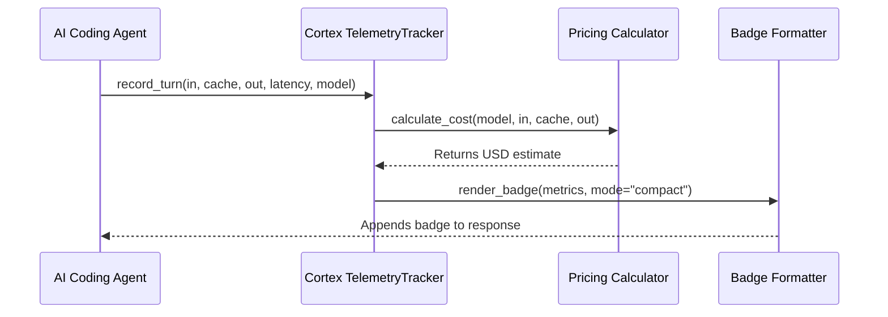

# Architecture: Token Telemetry Engine

The Telemetry Engine provides real-time per-response cost calculation, prompt caching efficiency auditing, and latency tracking.

---

## Metric Pipeline

---

## Token Calculation Formulas

1. **Prompt Cache Hit Rate:**
   $$\text{Hit Rate} = \frac{\text{Cached Tokens}}{\text{Input Tokens} + \text{Cached Tokens}} \times 100\%$$

2. **Cost Calculation:**
   $$\text{Cost} = \left(\frac{\text{Input}}{10^6} \times P_{\text{in}}\right) + \left(\frac{\text{Cached}}{10^6} \times P_{\text{cache}}\right) + \left(\frac{\text{Output}}{10^6} \times P_{\text{out}}\right)$$

3. **Generation Speed:**
   $$\text{Speed} = \frac{\text{Output Tokens}}{\text{Latency (seconds)}} \quad (\text{tokens/sec})$$

---

## Supported Badge Modes

| Mode | Format Preview |
| :--- | :--- |
| **`compact`** *(Default)* | `Token Telemetry: In: 3.1k \| Cache: 83.7k \| Out: 225 \| Total: 87.0k` |
| **`detailed`** | `📊 NexusPilot \| In: 3.1k \| Cache: 83.7k (96.4% hit) \| Out: 225 \| Speed: 187 tok/s \| Cost: $0.0018` |
| **`pill`** | `> ⚡ **Telemetry**: In: `3.1k` · Cache: `83.7k` (96%) · Out: `225` · Total: `87.0k`` |
| **`silent`** | Suppresses inline badges; logs metrics exclusively to session ledger. |
